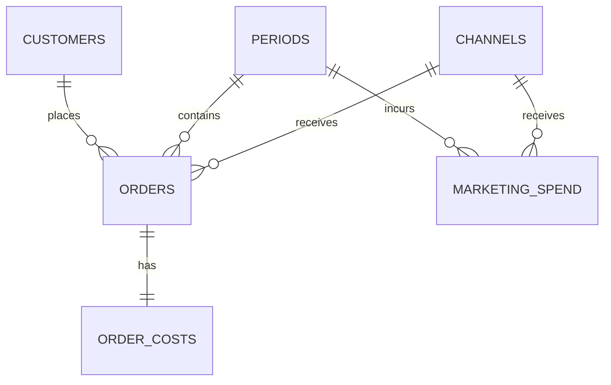

# Data dictionary and relationship guide

## Business definitions
- **Eligible order:** status = COMPLETED. Cancelled orders are excluded from recognised revenue, completed-order count and purchasing-customer count.
- **Net revenue:** gross_amount − discount_amount − refund_amount, on eligible orders only. Do not subtract discounts again in costs.
- **Purchasing customers:** distinct customer_id among eligible orders in the chosen period. The registry includes people with no eligible purchase.
- **Frequency:** completed orders / purchasing customers, over the same period and population.
- **Revenue per order:** net revenue / completed orders. This is a mean, not the median order value.
- **Specified costs:** all recorded product + fulfilment + payment costs, plus historical marketing spend in the same period. All pre-dispatch cancellations have zero tracked order costs in this dataset.
- **Contribution:** net revenue − specified costs. This is a teaching contribution measure, not net profit. Payroll, rent, depreciation, financing and income tax are outside the dataset.
- **Contribution margin:** contribution / net revenue. Aggregate components first; do not average row-level margin percentages.
- **Growth:** current / previous − 1. Multiply by 100 for percent display. A 20% to 15% margin change is −5 percentage points, not −5%.
- **Future agreement:** 15% revenue growth over the next annual reporting period and a 20% contribution-margin floor. The floor is the previous year's reference level; current margin is to be discovered. A successful analysis does not demonstrate that a future intervention has worked.

## Data scope and precision
Every file is UTF-8 CSV with a header. No required fields are missing. IDs are text. Money is nonnegative integer INR; CSV readers initially return strings, so convert monetary columns to integers. The snapshot is closed at 31 March 2026; historical partial refunds are settled and assigned to the same financial year as their order for this lab. There are no line-item, inventory, tax or refund-event tables. This simplification is deliberate.

Segments are stable customer attributes, not time-varying histories. Channels are order attributes; one customer can use several channels. Consequently, unique customers can be added across disjoint segments within a year, but cannot generally be added across channels or years. Signup is registration, not first completed purchase.

## Entity relationships

| Parent | Child | Cardinality | Join guidance |
|---|---|---|---|
| customers.customer_id | orders.customer_id | 1 to many | Join once to attach a stable customer segment. Registered customers are not the purchasing denominator. |
| periods.period_id | orders.period_id | 1 to many | Attach period dates and labels. |
| channels.channel_id | orders.channel_id | 1 to many | Attach sales-channel name. |
| orders.order_id | order_costs.order_id | 1 to exactly 1 | Safe direct order join; every order has one cost row. |
| periods.period_id | marketing_spend.period_id | 1 to many | Aggregate marketing by period before comparing with annual revenue. |
| channels.channel_id | marketing_spend.channel_id | 1 to many | Marketing-channel dimension; not an order-to-spend allocation. |

**Marketing join warning:** a period has many orders and many marketing-spend rows. Joining the detail tables using period_id repeats both measures. Aggregate revenue, order costs and marketing independently to one row per period; then join those summaries. Marketing costs are not allocated to individual customers in this dataset.

## Field dictionary
All fields are required; none are nullable in the supplied SQLite schema.

| Table | Field | Type / unit | Key | Example | Meaning | Rule |
|---|---|---|---|---|---|---|
| periods | period_id | TEXT | PK | FY2024_25 | Financial-year key. | FY2024_25 or FY2025_26 |
| periods | period_label | TEXT |  | FY 2024-25 | Human-readable financial year. | Two labels |
| periods | start_date | DATE |  | 2024-04-01 | Inclusive reporting start. | ISO YYYY-MM-DD |
| periods | end_date | DATE |  | 2025-03-31 | Inclusive reporting end. | ISO YYYY-MM-DD |
| periods | role | TEXT |  | previous | Chronological role in comparison. | previous or current |
| channels | channel_id | TEXT | PK | APP | Stable channel key. | APP, WEB, STORE |
| channels | channel_name | TEXT |  | Mobile app | Channel display name. | Three channel names |
| customers | customer_id | TEXT | PK | C000001 | Synthetic customer key; not a person identifier. | C followed by six digits |
| customers | segment | TEXT |  | Retail-Core | Stable customer segment for both years. | Business, Retail-Core, Retail-Plus, Student |
| customers | city | TEXT |  | Gurugram | Synthetic home city. | Ten Indian cities |
| customers | region | TEXT |  | North | Region associated with city. | North, South, East, West |
| customers | signup_date | DATE |  | 2023-05-18 | Registration date; precedes every order. | ISO YYYY-MM-DD |
| orders | order_id | TEXT | PK | O0000001 | Synthetic order key. | O followed by seven digits |
| orders | customer_id | TEXT | FK customers.customer_id | C000001 | Customer placing the order. | Must exist in customers |
| orders | period_id | TEXT | FK periods.period_id | FY2024_25 | Financial year containing order_date. | Must exist in periods |
| orders | order_date | DATE |  | 2024-06-15 | Order booking date; recognition assigned to this financial year. | ISO date inside its period |
| orders | channel_id | TEXT | FK channels.channel_id | APP | Channel in which this order was placed. | Must exist in channels |
| orders | status | TEXT |  | COMPLETED | Final order state at the closed snapshot. | COMPLETED or CANCELLED |
| orders | gross_amount | INTEGER INR |  | 28500 | Value before discounts and refunds; excludes indirect tax. | Nonnegative whole rupees |
| orders | discount_amount | INTEGER INR |  | 1500 | Discount already granted on the order. | Nonnegative; gross >= discount + refund |
| orders | refund_amount | INTEGER INR |  | 1000 | Settled partial refund assigned to this order and period. | Nonnegative; gross >= discount + refund |
| order_costs | order_id | TEXT | PK; FK orders.order_id | O0000001 | The order to which the cost record belongs. | Exactly one row for every order |
| order_costs | product_cost | INTEGER INR |  | 16000 | Recognised product cost after applicable recoveries. | Nonnegative whole rupees |
| order_costs | fulfilment_cost | INTEGER INR |  | 750 | Recognised packing, shipping and handling cost. | Nonnegative whole rupees |
| order_costs | payment_cost | INTEGER INR |  | 240 | Recognised payment processing cost. | Nonnegative whole rupees |
| marketing_spend | spend_id | TEXT | PK | M00001 | Historical expense-record key. | M followed by five digits |
| marketing_spend | period_id | TEXT | FK periods.period_id | FY2024_25 | Period in which expense was incurred. | Must exist in periods |
| marketing_spend | month_start | DATE |  | 2024-04-01 | Accounting month, represented by its first day. | Inside associated period |
| marketing_spend | channel_id | TEXT | FK channels.channel_id | WEB | Channel receiving this marketing expenditure. | Must exist in channels |
| marketing_spend | purpose | TEXT |  | Acquisition | Historical expenditure purpose. | Acquisition or Retention |
| marketing_spend | amount | INTEGER INR |  | 620000 | Cost incurred in this month/channel/purpose. | Nonnegative whole rupees |

## Prepared SQL view
`eligible_orders` is a view, not an extra source file. It exposes order_id, customer_id, period_id, order_date, channel_id and computed net_revenue for completed orders. Inspect its definition in `sql/schema.sql`. Using the view is the scaffolded route; calculating eligibility and net revenue from `orders` is the independent route.

## Practical joins for today
Exercise 1 can use orders and periods only. Exercise 2 adds order_costs (join on order_id) and marketing_spend (aggregate separately by period). Customers and channels are available for the next session's grouping and distributions. No product table is required because this activity analyses orders rather than line items.
